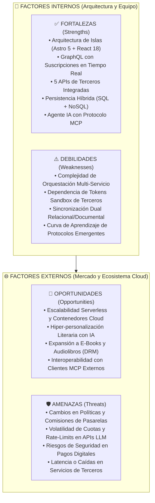
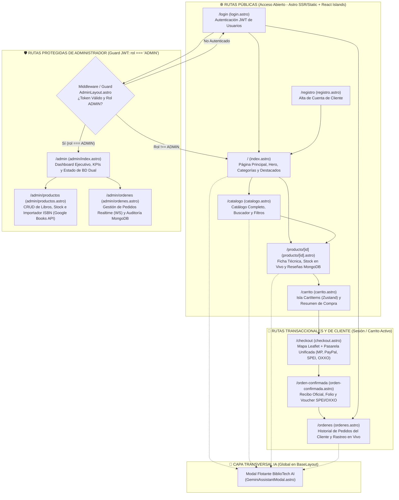
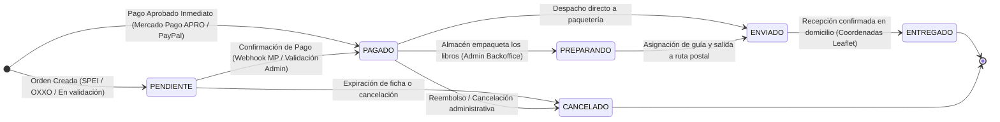
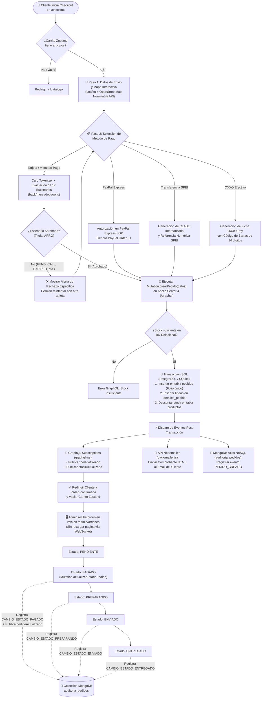
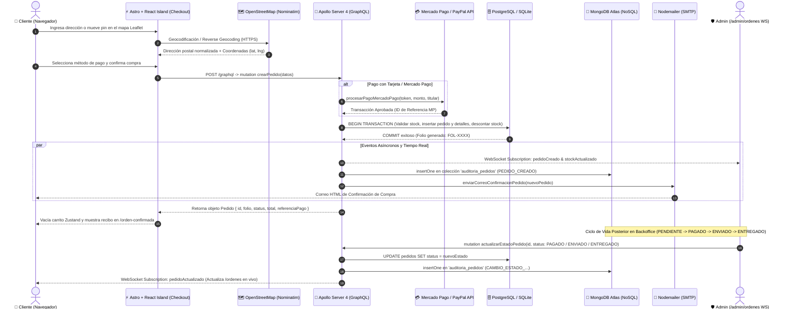

# Documentación Formal de Ingeniería de Software — Paso 5 (Entrega Final)
## Proyecto Integrador: **BiblioTech Store** (E-Commerce Full-Stack de Libros)

---

### Datos de Identificación Académica

| Campo | Detalle |
| :--- | :--- |
| **Institución** | Centro de Enseñanza Técnica Industrial (CETI — Plantel Colomos) |
| **Materia** | Programación Web II |
| **Docente** | Ing. Octavio Villavicencio Cruz |
| **Equipo** | **Equipo Dinamita** |
| **Integrantes** | • Reyes González Héctor Emiliano (Reg. `23100134`) • Covarrubias Alvarez Hugo Emmanuel (Reg. `23100080`) • Pérez Velázquez Rafael (Reg. `22100165`) • Yáñez Rodríguez Alan Omar (Reg. `22300896`) |
| **Arquitectura** | Astro 5 + React 18 (Islands + Zustand) \| Node.js + Apollo Server 4 (GraphQL HTTP + WebSockets `graphql-ws`) \| Dual DB (PostgreSQL / SQLite + MongoDB Atlas / JSON Local) \| Model Context Protocol (MCP) + Google Gemini 2.5 Flash |

---

## 1. Análisis FODA (SWOT) de la Plataforma

El análisis **FODA (Fortalezas, Oportunidades, Debilidades y Amenazas)** evalúa la viabilidad técnica, operativa y comercial de **BiblioTech Store** como plataforma moderna de comercio electrónico literario.

### 1.1. Fortalezas (Factores Internos Positivos)

1. **Arquitectura Frontend Desacoplada de Alto Rendimiento (Astro 5 + React 18 Islands + Zustand):**
   * Emplea hidratación parcial (*Partial Hydration*): las páginas de contenido (catálogo, detalle de producto, paneles informativos) se sirven como HTML estático/SSR ultraligero, hidratando únicamente las islas interactivas críticas (`AddToCart`, `CartItems`, `CheckoutForm`, `PaymentGateway`, `ProductQuantity`, `ToastContainer`).
   * Estado global del carrito persistido reactivamente con **Zustand** y sincronizado entre pestañas y componentes mediante eventos del navegador.
2. **API Unificada con GraphQL y Tiempo Real (`Apollo Server 4` + `graphql-ws`):**
   * Un único endpoint (`/graphql`) resuelve consultas anidadas (`Query`), operaciones transaccionales (`Mutation`) y eventos en vivo por WebSockets (`Subscription`: `pedidoCreado`, `pedidoActualizado`, `stockActualizado`), eliminando el *over-fetching* de REST tradicional.
3. **Ecosistema Completo de 5 APIs de Terceros Verificadas:**
   * **Mercado Pago Checkout API:** Tokenización de tarjetas y motor de validación de los 17 escenarios oficiales de aprobación y rechazo (`FUND`, `CALL`, `EXPIRED`, `BAD_CVV`, etc.) + endpoint Webhook (`/webhook/mercadopago`).
   * **PayPal Express Checkout SDK:** Flujo de autorización digital internacional con captura inmediata de orden.
   * **Leaflet + OpenStreetMap (Nominatim API):** Geolocalización interactiva con geocodificación directa e inversa para precisión de entrega postal.
   * **Nodemailer (SMTP Transaccional):** Despacho automático de comprobantes de compra en formato HTML enriquecido al confirmar cada pedido.
   * **Google Books API (con Fallback a Open Library API):** Autocompletado inteligente de metadatos bibliográficos (título, autor, editorial, páginas, sinopsis y portada HTTPS) por código ISBN en `/admin/productos`.
4. **Persistencia Políglota y Resiliente (Modo Dual SQL + NoSQL):**
   * **Motor Relacional (`back/postgres.js` + `back/db.js`):** Garantiza integridad referencial ACID para usuarios, categorías, inventario de libros, pedidos y líneas de detalle en **PostgreSQL**, con *fallback* automático transparente a **SQLite (`ecommerce.db`)** para ejecución local sin fricción.
   * **Motor Documental NoSQL (`back/mongodb.js`):** Gestiona datos semiestructurados de alta frecuencia de escritura en **MongoDB Atlas** (colecciones `resenas` y `auditoria_pedidos`), con respaldo local automático en JSON (`back/data/`) en caso de desconexión de red.
5. **Innovación con Inteligencia Artificial y Model Context Protocol (MCP):**
   * Servidor oficial **MCP (`back/mcp_server.js`)** compatible con transporte `stdio` (para Claude Desktop / Cursor) y endpoints HTTP (`/mcp`, `/mcp/tools`, `/mcp/call`), exponiendo 4 herramientas de negocio en tiempo real (`search_books`, `check_stock`, `get_order_status`, `get_store_kpis`) consumidas por el asistente flotante **Google Gemini (`gemini-2.5-flash`)** con *Function Calling*.
6. **Automatización DevOps (CI/CD):**
   * Pipeline en GitHub Actions (`.github/workflows/ci-cd.yml`) que valida sintaxis de módulos, levanta el servidor híbrido HTTP/WS, verifica `/health`, ejecuta pruebas automatizadas de suscripciones GraphQL y compila el artefacto de producción listo para Netlify.

---

### 1.2. Oportunidades (Factores Externos Positivos)

1. **Escalabilidad Nativa en la Nube (Cloud-Native Deployment):**
   * La separación estricta entre `front/` y `back/` permite desplegar el frontend en redes CDN globales (**Netlify / Vercel**) y el backend en contenedores elásticos (**Render / Railway / Fly.io**) conectados a clusters administrados como **Supabase/Neon (PostgreSQL)** y **MongoDB Atlas**.
2. **Hiper-personalización de Recomendaciones Literarias con IA:**
   * Aprovechando las reseñas almacenadas en MongoDB (`resenas`) y el historial de compras relacional, el agente Gemini con MCP puede evolucionar hacia un recomendador semántico personalizado por perfil lector.
3. **Expansión hacia Formatos Digitales (Audiolibros y E-Books):**
   * El esquema GraphQL y la pasarela de pagos unificada permiten incorporar descargas instantáneas de EPUB/PDF y streaming de audiolibros sin costos de envío físico.
4. **Comercio Conversacional (Agentic Commerce vía MCP):**
   * Al contar con un servidor MCP estándar, cualquier cliente externo de IA autorizado puede consultar el catálogo de BiblioTech, verificar existencias y asistir en compras desde entornos de escritorio o móviles.

---

### 1.3. Debilidades (Factores Internos a Mejorar)

1. **Complejidad de Orquestación Full-Stack:**
   * La coexistencia de servidor HTTP GraphQL, servidor WebSocket (`graphql-ws`), proceso MCP (`stdio`/HTTP), base de datos relacional y base de datos documental incrementa la complejidad de configuración y monitoreo frente a un monolito tradicional.
2. **Dependencia de Credenciales y Tokens de Terceros en Modo Sandbox:**
   * El funcionamiento completo en la nube requiere administrar múltiples variables sensibles (`GEMINI_API_KEY`, `MP_ACCESS_TOKEN`, `MONGODB_URI`, `DATABASE_URL`, `SMTP_USER`, `SMTP_PASS`). Aunque el sistema incluye *fallbacks* locales para todas ellas, la transición a producción exige una gestión rigurosa de secretos.
3. **Consistencia Eventual entre Motores Relacional y NoSQL:**
   * El recálculo del promedio de calificación (`rating` y `resenasCount`) del libro en la base relacional tras insertar un documento en la colección `resenas` de MongoDB opera bajo consistencia eventual y no mediante transacciones distribuidas (2PC).

---

### 1.4. Amenazas (Factores Externos de Riesgo)

1. **Cambios en Políticas, Versiones o Comisiones de Pasarelas de Pago:**
   * Actualizaciones deprecatorias en los SDKs de **Mercado Pago** o **PayPal**, o incrementos en las comisiones por transacción, pueden impactar el flujo de caja o requerir refactorizaciones en el módulo de checkout.
2. **Volatilidad de Cuotas, Precios y *Rate-Limits* en Modelos de Lenguaje (LLMs):**
   * La API de **Google Gemini** y servicios de geocodificación gratuita como **Nominatim (OpenStreetMap)** imponen límites de peticiones por minuto (*rate limiting*). Un pico de tráfico o ataque de bots al chat de IA podría agotar la cuota gratuita si no se aplican políticas estrictas de *throttling*.
3. **Restricciones de Red y Bloqueos de Puertos SMTP/WebSockets:**
   * Algunos proveedores de hosting gratuito o redes corporativas/escolares restringen conexiones salientes en el puerto SMTP (`587`/`465`) o cortan conexiones WebSocket persistentes de larga duración.

---

### 1.5. Estrategias Cruzadas (Matriz CAME / FO-FA-DO-DA)

| Estrategia | Cruce | Acción Estratégica en BiblioTech Store |
| :--- | :--- | :--- |
| **Estrategia Ofensiva (FO)** | Fortaleza + Oportunidad | Explotar el servidor **MCP + Gemini** y el despliegue en **Netlify/Render** para posicionar a BiblioTech como una librería pionera con asistente literario inteligente en tiempo real. |
| **Estrategia Defensiva (FA)** | Fortaleza + Amenaza | Utilizar la arquitectura de **Modo Dual con Fallback Automático** (SQLite, JSON local y Sandbox inteligente de Gemini/Nodemailer) para garantizar disponibilidad continua (`99.9%` uptime funcional) incluso ante caídas o límites de cuota de APIs externas. |
| **Estrategia de Reorientación (DO)** | Debilidad + Oportunidad | Automatizar la validación de la orquestación full-stack mediante el pipeline **CI/CD en GitHub Actions**, reduciendo el error humano durante los despliegues a la nube. |
| **Estrategia de Supervivencia (DA)** | Debilidad + Amenaza | Desacoplar cada proveedor externo en módulos adaptadores independientes (`mercadopago.js`, `mailer.js`, `gemini_assistant.js`, `mongodb.js`, `postgres.js`) para sustituir o actualizar cualquier SDK sin afectar el núcleo de negocio. |

---

## 2. Matriz SFW (Scope of Functional Work) — Alcance Funcional

La siguiente **Matriz SFW (Scope of Functional Work)** define el alcance funcional íntegro del sistema **BiblioTech Store**, detallando los módulos, actores, requerimientos funcionales, componentes técnicos involucrados y criterios de aceptación verificados.

| ID | Módulo Funcional | Rol / Actor | Descripción del Alcance y Reglas de Negocio | Componentes Frontend (`front/`) | Operaciones Backend GraphQL / REST / MCP (`back/`) | Persistencia / API Externa | Estado |
| :---: | :--- | :---: | :--- | :--- | :--- | :--- | :---: |
| **SFW-01** | **Autenticación y Seguridad JWT** | Visitante, Cliente, Admin | Registro de nuevos clientes, inicio de sesión con credenciales, emisión de token firmado (`Bearer`), validación de sesión activa y protección de rutas administrativas (`requireAdmin` / Guard en `AdminLayout.astro`). | `pages/login.astro` `pages/registro.astro` `services/auth.js` `layouts/AdminLayout.astro` | • `Mutation.login` • `Mutation.registro` • `Query.me` • Middleware HTTP y `onConnect` WS | Tabla `usuarios` (PostgreSQL / SQLite) + Tokens firmados con HMAC/Base64 | ✅ 100% |
| **SFW-02** | **Catálogo, Búsqueda y Filtros** | Público / Cliente | Exploración del catálogo literario, filtrado dinámico por categoría (`Ciencia Ficción`, `Fantasía`, `Terror`, `Desarrollo Web`), búsqueda por texto libre (título/autor/ISBN), ordenamiento y vista detallada de ficha técnica. | `pages/index.astro` `pages/catalogo.astro` `pages/producto/[id].astro` | • `Query.productos` • `Query.producto(id)` • `Query.categorias` • `Query.categoria(id)` | Tablas `productos` y `categorias` (PostgreSQL / SQLite) | ✅ 100% |
| **SFW-03** | **Carrito de Compras Reactivo** | Público / Cliente | Adición de libros con validación de stock disponible, ajuste de cantidades (`+`/`-`), eliminación de ítems, cálculo reactivo de subtotal, costo de envío (gratis en compras $\ge \$599$ MXN) y persistencia en `localStorage`. | `pages/carrito.astro` `islands/AddToCart.jsx` `islands/CartItems.jsx` `islands/ProductQuantity.jsx` `store/cartStore.js` | Sincronización de stock en vivo mediante `Subscription.stockActualizado` | `localStorage` (`bibliotech-cart-storage`) + Estado global en **Zustand** | ✅ 100% |
| **SFW-04** | **Geolocalización y Dirección de Envío** | Cliente | Mapa interactivo para seleccionar el punto exacto de entrega mediante marcador arrastrable, búsqueda de dirección postal (geocodificación directa) y autocompletado del formulario al hacer clic en el mapa (geocodificación inversa). | `pages/checkout.astro` `islands/CheckoutForm.jsx` | Recibe la dirección validada y coordenadas dentro de `PedidoInput.direccionEnvio` | **API Externa #3:** **Leaflet.js + OpenStreetMap / Nominatim API** | ✅ 100% |
| **SFW-05** | **Pasarelas de Pago Unificadas** | Cliente | Procesamiento multipasarela en una sola interfaz: 1. **Mercado Pago / Tarjeta Bancaria:** Card Tokenizer y evaluación estricta de los 17 escenarios oficiales (`APRO`, `FUND`, `CALL`, `EXPIRED`, `BAD_CVV`, etc.). 2. **PayPal Express SDK:** Captura de orden digital. 3. **SPEI:** Generación de CLABE interbancaria y referencia. 4. **OXXO Pay:** Generación de ficha con código de barras. | `pages/checkout.astro` `islands/PaymentGateway.jsx` `pages/orden-confirmada.astro` | • `Mutation.crearPedido` • `POST /webhook/mercadopago` • Módulo `back/mercadopago.js` | **API Externa #1:** **Mercado Pago Checkout API** **API Externa #2:** **PayPal Express SDK** Tablas `pedidos` y `detalles_pedido` | ✅ 100% |
| **SFW-06** | **Notificaciones Transaccionales por Email** | Sistema / Cliente | Generación y envío automático de comprobante fiscal/digital en HTML con desglose de folio, método de pago, referencia, dirección y tabla de libros adquiridos inmediatamente después de crear el pedido. | Confirmación visual en `pages/orden-confirmada.astro` y `pages/ordenes.astro` | • Invocado en `Mutation.crearPedido` • Módulo `back/mailer.js` (`enviarCorreoConfirmacionPedido`) | **API Externa #4:** **Nodemailer (SMTP / Ethereal Sandbox)** | ✅ 100% |
| **SFW-07** | **Panel de Administración (Backoffice & Realtime)** | Admin (`rol: ADMIN`) | Dashboard de KPIs financieros (`ventasTotales`, `totalPedidos`, desglose por estatus), CRUD completo de libros, ajuste rápido de stock, importación automática de metadatos por ISBN y gestión de órdenes en tiempo real vía WebSockets. | `pages/admin/index.astro` `pages/admin/productos.astro` `pages/admin/ordenes.astro` `layouts/AdminLayout.astro` | • `Query.adminKPIs`, `Query.pedidos` • `Mutation.crearProducto`, `actualizarProducto`, `actualizarStock`, `eliminarProducto`, `actualizarEstadoPedido` • `Subscription.pedidoCreado`, `pedidoActualizado`, `stockActualizado` | **API Externa #5:** **Google Books API** (+ Fallback Open Library API) WebSockets (`graphql-ws`) + BD Relacional | ✅ 100% |
| **SFW-08** | **Reseñas y Calificaciones NoSQL** | Cliente / Público | Consulta y publicación de reseñas verificadas con calificación de 1 a 5 estrellas y comentario en cada página de libro, recalculando automáticamente el promedio (`rating`) y total de opiniones (`resenasCount`) del producto. | `pages/producto/[id].astro` (Sección interactiva de Reseñas MongoDB) | • `Query.resenasPorProducto` • `Mutation.crearResena` • Módulo `back/mongodb.js` (`mongoReviews`) | **MongoDB Atlas NoSQL** — Colección `resenas` (con fallback a `back/data/mongodb_resenas.json`) | ✅ 100% |
| **SFW-09** | **Trazabilidad y Auditoría de Pedidos NoSQL** | Admin / Sistema | Registro inmutable de eventos del ciclo de vida de cada orden (`PEDIDO_CREADO`, `CAMBIO_ESTADO_PAGADO`, `CAMBIO_ESTADO_PREPARANDO`, `CAMBIO_ESTADO_ENVIADO`, `CAMBIO_ESTADO_ENTREGADO`, `CAMBIO_ESTADO_CANCELADO`) con consulta de línea de tiempo desde el Backoffice. | `pages/admin/ordenes.astro` (Botón y línea de tiempo *"📜 Ver Trazabilidad MongoDB"*) | • `Query.auditoriaPedido` • `Query.todasAuditorias` • `Query.statusBasesDeDatos` • Módulo `back/mongodb.js` (`mongoAudit`) | **MongoDB Atlas NoSQL** — Colección `auditoria_pedidos` (con fallback a `back/data/mongodb_auditoria.json`) | ✅ 100% |
| **SFW-10** | **Asistente IA con Model Context Protocol (MCP)** | Cliente / Admin / Agentes IA | Widget conversacional flotante impulsado por **Google Gemini (`gemini-2.5-flash`)** conectado con *Function Calling* a 4 herramientas MCP para buscar libros, consultar existencias/precios en vivo, rastrear pedidos por folio (incluyendo auditoría MongoDB) y consultar KPIs. | `components/GeminiAssistantModal.astro` (Integrado globalmente en `BaseLayout.astro`) | • `POST /api/chat-gemini` • `GET /mcp`, `GET /mcp/tools`, `POST /mcp/call` • Servidor `stdio` `back/mcp_server.js` • `back/mcp_tools.js` y `back/gemini_assistant.js` | **Google GenAI SDK (`@google/genai`)** + **MCP SDK (`@modelcontextprotocol/sdk`)** | ✅ 100% |

---

## 3. Mapas de Navegación y Flujo de Procesos

### 3.1. Diagrama Sitemap (Mapa de Navegación de Rutas Públicas, Protegidas y Administrativas)

El siguiente diagrama representa la arquitectura de navegación completa de **BiblioTech Store**, diferenciando las **Rutas Públicas**, las **Rutas Transaccionales / Protegidas de Cliente**, las **Rutas Protegidas de Administrador (RBAC `rol === 'ADMIN'`)** y su comunicación con los **Servicios del Backend**.

#### Tabla Descriptiva de Rutas y Control de Acceso

| Ruta URL | Archivo Fuente (`front/src/pages/`) | Nivel de Acceso | Propósito Principal |
| :--- | :--- | :---: | :--- |
| `/` | `index.astro` | Público | Escaparate principal con libros destacados, categorías e indicadores de la librería. |
| `/catalogo` | `catalogo.astro` | Público | Buscador avanzado con filtros por categoría, rango de precios y disponibilidad. |
| `/producto/[id]` | `producto/[id].astro` | Público / Mixto | Ficha completa del libro, selector de cantidad reactivo y módulo de reseñas NoSQL (`resenas`). |
| `/carrito` | `carrito.astro` | Público | Gestión de artículos seleccionados en `useCartStore` (Zustand) con cálculo de envío. |
| `/login` | `login.astro` | Público | Inicio de sesión mediante `Mutation.login` y almacenamiento de JWT en `localStorage`. |
| `/registro` | `registro.astro` | Público | Registro de nuevos clientes con `Mutation.registro` e inicio de sesión automático. |
| `/checkout` | `checkout.astro` | Transaccional | Geolocalización de entrega con **Leaflet/Nominatim** y pago multipasarela (**Mercado Pago**, **PayPal**, **SPEI**, **OXXO**). |
| `/orden-confirmada` | `orden-confirmada.astro` | Transaccional | Comprobante post-compra con folio único, resumen de artículos e instrucciones de pago. |
| `/ordenes` | `ordenes.astro` | Protegida (Cliente) | Consulta de órdenes propias (`Query.misPedidos`) con actualizaciones de estado en tiempo real vía WebSockets. |
| `/admin` | `admin/index.astro` | Protegida (`ADMIN`) | Panel de control con métricas `adminKPIs` y monitoreo de conexiones PostgreSQL/SQLite y MongoDB. |
| `/admin/productos` | `admin/productos.astro` | Protegida (`ADMIN`) | Alta, edición, baja y control de stock de libros + autocompletado por ISBN con **Google Books API**. |
| `/admin/ordenes` | `admin/ordenes.astro` | Protegida (`ADMIN`) | Tablero en tiempo real (`graphql-ws`) para cambiar estados de órdenes y auditar eventos en **MongoDB Atlas**. |

---

### 3.2. Diagrama de Flujo del Proceso de Checkout y Ciclo de Vida del Pedido

A continuación se documenta el flujo completo del proceso de **Checkout Unificado** y la **Máquina de Estados del Pedido** (`PENDIENTE` -> `PAGADO` -> `PREPARANDO` -> `ENVIADO` -> `ENTREGADO`), abarcando la validación de pago, descuento transaccional de stock, notificaciones WebSocket, envío de correo y auditoría NoSQL.

#### A) Diagrama de Máquina de Estados del Pedido (Ciclo de Vida Oficial)

#### B) Diagrama de Flujo Completo del Checkout y Procesamiento de Orden

#### C) Diagrama de Secuencia End-to-End (Checkout, Notificaciones y Auditoría)

---

## 4. Guía de Despliegue en Producción (Paso 6)

### 4.1. Despliegue del Frontend en Netlify
El repositorio incluye el archivo de configuración declarativa `netlify.toml` en la raíz y el workflow `.github/workflows/ci-cd.yml`:

* **Base directory:** `front`
* **Build command:** `npm run build`
* **Publish directory:** `front/dist`
* **Variables de Entorno en Netlify:**
  * `PUBLIC_GRAPHQL_URL`: URL pública del backend desplegado (ej. `https://bibliotech-backend.onrender.com/graphql`)

### 4.2. Despliegue del Backend en Render / Railway
* **Root Directory:** `back`
* **Build Command:** `npm install`
* **Start Command:** `npm start` (ejecuta `node index.js`)
* **Health Check Path:** `/health`
* **Variables de Entorno Opcionales (Modo Cloud):**
  * `PORT`: `4000` (o asignado automáticamente por el PaaS)
  * `DATABASE_URL`: Cadena de conexión a PostgreSQL (Supabase / Neon / Render Postgres)
  * `MONGODB_URI`: Cadena de conexión a MongoDB Atlas (`mongodb+srv://...`)
  * `GEMINI_API_KEY`: API Key de Google AI Studio para Gemini 2.5 Flash
  * `MP_ACCESS_TOKEN`: Token de Mercado Pago
  * `SMTP_HOST`, `SMTP_PORT`, `SMTP_USER`, `SMTP_PASS`: Credenciales SMTP para Nodemailer
*(Nota: Si alguna variable opcional no se define, el servidor activa automáticamente sus adaptadores locales SQLite, JSON persistente y Sandbox sin interrumpir el servicio).*
