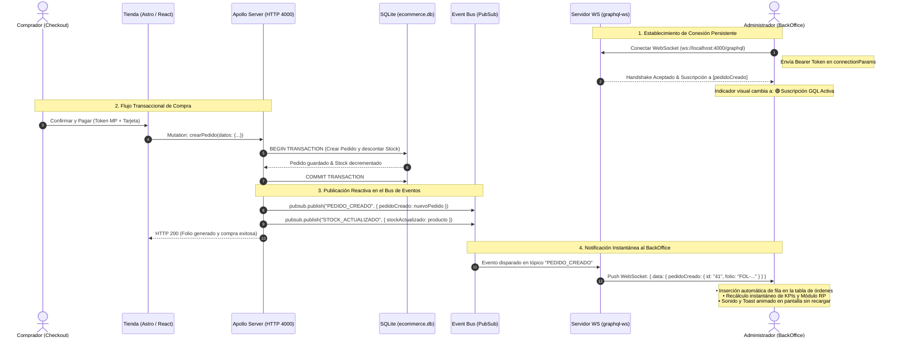
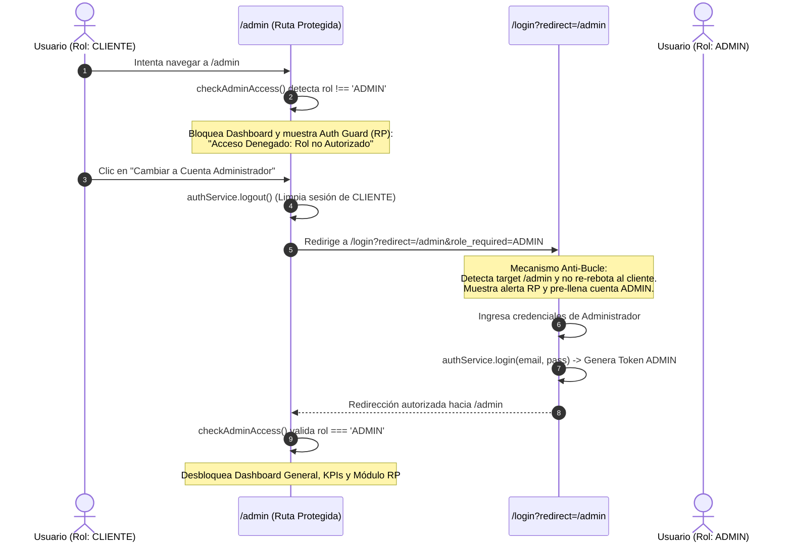

# Reporte de Práctica — Programación Web II
## Full BackOffice con GraphQL Subscriptions en Tiempo Real (`graphql-ws`), Rutas Protegidas (RP) y Módulo de Reportes

---

## 1. Portada Oficial

| Campo | Dato |
|---|---|
| **Institución** | Centro de Enseñanza Técnica Industrial (CETI) — Plantel Colomos |
| **División** | División de Tecnologías de la Información y Comunicación |
| **Carrera** | Ingeniería en Desarrollo de Software (8A1) |
| **Materia** | Programación Web II / Proyecto Integrador de Desarrollo de Software |
| **Profesor Titular** | Octavio Villavicencio Cruz |
| **Práctica / Proyecto** | Full BackOffice E-Commerce: GraphQL Subscriptions (`graphql-ws`), Rutas Protegidas (RP), Módulo de Reportes & Pasarela Unificada |
| **Equipo "Dinamita"** | • Héctor Emiliano Reyes González (Registro: 23100134) — *Backend & Subscriptions Lead*<br>• Hugo Emmanuel Covarrubias Álvarez (Registro: 23100080) — *Frontend Architect & UI*<br>• Rafael Pérez Velázquez (Registro: 22100165) — *BackOffice UI & Client Subscriptions*<br>• Alan Omar Yáñez Rodríguez (Registro: 22300896) — *Orders & Inventory Realtime Flow* |
| **Repositorio GitHub** | [https://github.com/wilfultortoise-sudo/equipodinamita](https://github.com/wilfultortoise-sudo/equipodinamita) |
| **Rama Principal** | `main` |
| **Despliegue Web (Demo)** | [https://integrador-ecommerce-ssd.netlify.app/](https://integrador-ecommerce-ssd.netlify.app/) |
| **Servidor Frontend Local** | [http://localhost:4321](http://localhost:4321) (Astro 5 + Vite) |
| **Servidor Backend Local** | [http://localhost:4000/graphql](http://localhost:4000/graphql) (HTTP) / `ws://localhost:4000/graphql` (WS) |
| **Fecha de Entrega** | Octubre de 2026 |

---

## 2. Enlaces del Proyecto y Commits Clave

- **Repositorio Oficial:** [https://github.com/wilfultortoise-sudo/equipodinamita](https://github.com/wilfultortoise-sudo/equipodinamita)
- **Commits Representativos de la Práctica:**
  - `ce1037f` — `feat(backoffice): resolver redireccion de login en rutas protegidas (RP) y consolidar modulo de reportes con GraphQL Subscriptions`
  - `c78f268` — `feat(checkout): unificar metodo de pago con Tarjeta y Mercado Pago Checkout API en una sola pestaña interactiva`
  - `6d6c6f4` — `fix(mercadopago): asegurar evaluacion estricta y sin fugas de los 17 escenarios oficiales de rechazo y aprobacion en Checkout API`
  - `3d8fd0d` — `feat(backend): Implementacion de GraphQL Subscriptions con WebSockets (graphql-ws) y PubSub`
  - `0e992eb` — `fix(backend): habilitar CORS global y soporte dual para endpoints / y /graphql`
- **Sandbox GraphQL:** [http://localhost:4000/graphql](http://localhost:4000/graphql)
- **Health Check Endpoint:** [http://localhost:4000/health](http://localhost:4000/health)
- **Panel General de BackOffice (Dashboard & Módulo RP):** [http://localhost:4321/admin](http://localhost:4321/admin)
- **Panel de Órdenes en Tiempo Real:** [http://localhost:4321/admin/ordenes](http://localhost:4321/admin/ordenes)
- **Gestión de Catálogo e Inventario (CRUD):** [http://localhost:4321/admin/productos](http://localhost:4321/admin/productos)

---

## 3. Resumen Ejecutivo

El presente proyecto documenta la consolidación del **Full BackOffice** para la plataforma de comercio electrónico de libros **BiblioTech Store**, integrando comunicación bidireccional reactiva impulsada por **GraphQL Subscriptions** sobre el protocolo moderno **`graphql-ws`** (WebSockets RFC 6455) y el patrón **PubSub**.

A su vez, se abordó de manera integral el requerimiento **"Backoffice: RP"**, satisfaciendo sus dos vertientes esenciales en la arquitectura web:
1. **Rutas Protegidas (RP - Role Protection):** Blindaje riguroso en cliente y servidor donde solo usuarios autenticados con rol `ADMIN` pueden consultar y operar los paneles administrativos. Se resolvió de raíz el problema clásico del bucle infinito de redirección al alternar sesiones de cliente a administrador.
2. **Módulo de Reportes (RP - Reporting & Analytics):** Panel ejecutivo con métricas financieras consolidadas, desglose de ventas por método de pago, monitoreo de cumplimiento logístico, exportación automatizada a archivo CSV (`Reporte_Backoffice_RP_BiblioTech.csv`) y vista optimizada para impresión o exportación a PDF.

Finalmente, como parte del flujo transaccional que alimenta las suscripciones en tiempo real, se documenta de forma sintética la **unificación de la pasarela de pagos con Tarjeta y Mercado Pago Checkout API** en una sola pestaña interactiva con tokenización en cliente (PCI-DSS) y matriz de validación de los 17 escenarios oficiales de prueba.

---

## 4. Marco Teórico y Fundamentos de Arquitectura

### 4.1. Paradigma de GraphQL Subscriptions vs. Sondeo Tradicional (Polling)
En arquitecturas web convencionales, para mantener una interfaz sincronizada con el servidor cuando ocurren eventos asíncronos (como la llegada de un nuevo pedido), se solía recurrir a técnicas de sondeo (*Short Polling* o *Long Polling*). Estas técnicas implican enviar peticiones HTTP repetitivas a intervalos fijos (ej. cada 2 segundos). Este enfoque presenta graves deficiencias:
- **Consumo innecesario de ancho de banda:** Cientos de peticiones HTTP vacías transmiten encabezados redundantes.
- **Sobrecarga del CPU en el servidor:** Desperdicio de recursos al consultar la base de datos repetidamente sin cambios.
- **Latencia percibida:** Los cambios solo se reflejan hasta que el siguiente ciclo de sondeo se completa.

Por el contrario, **GraphQL Subscriptions** establece un canal de comunicación reactivo y persistente. El cliente se suscribe declarando los campos específicos que desea recibir. Cuando un evento ocurre en el servidor, este "empuja" (*push notification*) la carga útil tipada a través del socket TCP sin que el frontend tenga que solicitarla, logrando tiempos de respuesta de milisegundos y minimizando el uso de recursos.

### 4.2. Protocolo WebSockets (RFC 6455) y la Especificación `graphql-ws`
El protocolo HTTP está diseñado para ciclos efímeros de petición-respuesta. **WebSockets** permite actualizar (*Upgrade*) la conexión HTTP inicial a un túnel TCP dúplex completo (*Full-Duplex*) bidireccional sobre el mismo puerto.

En el ecosistema GraphQL, la antigua biblioteca `subscriptions-transport-ws` quedó obsoleta por falta de mantenimiento y vulnerabilidades de memoria. En su lugar, el estándar de la industria es **`graphql-ws`**:
- Cumple con la especificación oficial del subprotocolo `graphql-transport-ws`.
- Gestión de latidos (*Keep-Alive / Pings & Pongs*) para detección inmediata de desconexiones.
- Cierre ordenado y liberación de memoria cuando los componentes de la interfaz se desmontan.
- Adaptador nativo de servidor mediante `useServer` compatible con Apollo Server v4.

### 4.3. Patrón Publicador / Suscriptor (PubSub)
Para desacoplar la lógica de negocio de la infraestructura de transporte, se implementó el patrón **PubSub**:
- **Publicador (`Publisher`):** En las mutaciones críticas (`crearPedido`, `actualizarEstadoPedido`, `actualizarStock`), el servidor emite el evento mediante `pubsub.publish(TOPIC, payload)`. El resolver de la mutación desconoce qué clientes están conectados.
- **Tópicos (`Topics`):** Identificadores inmutables de eventos (`PEDIDO_CREADO`, `PEDIDO_ACTUALIZADO`, `STOCK_ACTUALIZADO`).
- **Suscriptor (`Subscriber`):** Mediante `pubsub.asyncIterator([TOPIC])`, los resolvers de suscripción filtran los eventos y despachan las estructuras hacia los WebSockets autorizados.

### 4.4. Servidor Híbrido Unificado (HTTP + WS en Puerto 4000)
Para evitar conflictos de firewall, gestión dual de certificados SSL y problemas de enrutamiento en proxies inversos, el backend opera bajo un **servidor híbrido de puerto único**:
1. Se crea un servidor nativo de Node.js mediante `http.createServer(app)`.
2. **Express** atiende peticiones REST/HTTP estándar en el puerto `4000` (`expressMiddleware`).
3. Una instancia de **`WebSocketServer`** (`ws`) se vincula al mismo servidor HTTP escuchando el subprotocolo `graphql-transport-ws` en la ruta `/graphql`.
4. El plugin **`ApolloServerPluginDrainHttpServer`** garantiza que al apagar el servidor, las conexiones HTTP y los sockets persistentes se drenen de forma limpia sin corromper transacciones de base de datos.

### 4.5. Rutas Protegidas (RP) y Control de Acceso Basado en Roles (RBAC)
El concepto de **Rutas Protegidas (RP)** consiste en impedir el acceso de usuarios no autorizados tanto en la capa visual (páginas del frontend) como en la capa de datos (consultas y mutaciones de GraphQL):
- **Capa Cliente:** Los componentes tipo *Auth Guard* interceptan la renderización antes de pintar datos sensibles. Si la sesión no tiene rol `ADMIN`, bloquean la vista y ofrecen mecanismos explícitos de autenticación.
- **Capa Servidor:** En WebSockets, el cliente envía el token en `connectionParams` durante el handshake `connection_init`. En HTTP, viaja en la cabecera `Authorization: Bearer <token>`. Los resolvers validan la firma criptográfica del token y rechazan operaciones restringidas con excepciones de autorización.

---

## 5. Diagramas de Arquitectura y Secuencia

### 5.1. Flujo Reactivo de GraphQL Subscriptions en Tiempo Real



---

### 5.2. Flujo de Rutas Protegidas (RP) y Prevención de Bucle Infinito



---

## 6. Implementación Técnica Detallada

### 6.1. Servidor Híbrido HTTP + WebSockets (`back/index.js`)
El servidor backend gestiona tanto el tráfico estándar de mutaciones y consultas HTTP como el servidor de WebSockets en el mismo puerto `4000`:

```javascript
// Configuración de WebSocketServer dedicado sobre la ruta /graphql
const wsServer = new WebSocketServer({
  server: httpServer,
  path: '/graphql'
});

// useServer acopla graphql-ws con extracción de autenticación
const serverCleanup = useServer(
  {
    schema,
    context: async (ctx) => {
      const rawToken = ctx.connectionParams?.authorization || ctx.connectionParams?.Authorization || '';
      let currentUser = null;
      if (rawToken) {
        const decoded = verifyToken(rawToken);
        if (decoded?.id) currentUser = dbRepo.getUsuarioById(decoded.id);
      }
      return { token: rawToken, currentUser };
    }
  },
  wsServer
);
```

### 6.2. Módulo PubSub Singleton (`back/pubsub.js`)
Para evitar desincronización entre emisores y suscriptores, se centralizó el bus de eventos en memoria con polyfill de compatibilidad:

```javascript
import { PubSub } from 'graphql-subscriptions';

export const pubsub = new PubSub();

export const TOPICS = {
  PEDIDO_CREADO: 'PEDIDO_CREADO',
  PEDIDO_ACTUALIZADO: 'PEDIDO_ACTUALIZADO',
  STOCK_ACTUALIZADO: 'STOCK_ACTUALIZADO'
};

export const safePublish = (topic, payload) => {
  try {
    pubsub.publish(topic, payload);
  } catch (err) {
    console.error(`[PubSub Error] No se pudo publicar en ${topic}:`, err.message);
  }
};
```

### 6.3. Resolvers de Suscripción y Protección de Rol (`back/resolvers.js`)
El esquema SDL define el tipo raíz `Subscription`:

```graphql
type Subscription {
  pedidoCreado: Pedido!
  pedidoActualizado: Pedido!
  stockActualizado: Producto!
}
```

En los resolvers, las mutaciones publican reactivamente y las operaciones administrativas exigen rol `ADMIN`:

```javascript
function requireAdmin(context) {
  const user = requireAuth(context);
  if (user.rol !== 'ADMIN') {
    throw new Error('Acceso denegado: se requiere el rol ADMIN.');
  }
  return user;
}

// Resolver de mutación crearPedido
crearPedido: async (_, { datos }, context) => {
  // Procesamiento y guardado relacional en SQLite...
  const nuevoPedido = dbRepo.crearPedido(datos);
  safePublish(TOPICS.PEDIDO_CREADO, { pedidoCreado: nuevoPedido });
  return nuevoPedido;
},

// Resolvers de suscripción
Subscription: {
  pedidoCreado: {
    subscribe: () => pubsub.asyncIterator([TOPICS.PEDIDO_CREADO])
  },
  pedidoActualizado: {
    subscribe: () => pubsub.asyncIterator([TOPICS.PEDIDO_ACTUALIZADO])
  },
  stockActualizado: {
    subscribe: () => pubsub.asyncIterator([TOPICS.STOCK_ACTUALIZADO])
  }
}
```

### 6.4. Cliente WebSocket en el BackOffice (`front/src/pages/admin/ordenes.astro` e `index.astro`)
En el frontend, el navegador se conecta al endpoint `ws://localhost:4000/graphql` enviando el token en el mensaje `connection_init`:

```typescript
const socket = new WebSocket('ws://localhost:4000/graphql', 'graphql-transport-ws');

socket.onopen = () => {
  socket.send(JSON.stringify({
    type: 'connection_init',
    payload: { authorization: token ? `Bearer ${token}` : '' }
  }));
};

socket.onmessage = (event) => {
  const data = JSON.parse(event.data);
  if (data.type === 'connection_ack') {
    // Suscripción al tópico pedidoCreado
    socket.send(JSON.stringify({
      id: 'sub_admin_dashboard',
      type: 'subscribe',
      payload: {
        query: `subscription { pedidoCreado { id folio total status metodoPago fecha } }`
      }
    }));
  } else if (data.type === 'next' && data.payload?.data?.pedidoCreado) {
    const nuevo = data.payload.data.pedidoCreado;
    allOrders.unshift(nuevo);
    calculateKPIs();
    renderRPMetrics();
    renderOrdersTable();
    showToast(`🟢 ¡Nueva Orden #${nuevo.folio} recibida vía Subscriptions! ($${nuevo.total} MXN)`, 'success');
  }
};
```

---

## 7. BackOffice: Rutas Protegidas (RP) y Resolución del Bucle de Login

### 7.1. Diagnóstico del Error Previo
En versiones anteriores, cuando un usuario con rol `CLIENTE` accedía a `/admin`, la página mostraba la tarjeta de acceso denegado con un enlace hacia `/login?redirect=/admin`. Al hacer clic:
1. El script de `login.astro` evaluaba `authService.isAuthenticated()`, que devolvía `true` porque el cliente seguía logueado.
2. Al leer `redirect = '/admin'`, el script ejecutaba de inmediato `window.location.href = '/admin'`.
3. Al volver a `/admin`, se denegaba nuevamente el acceso.
4. El usuario quedaba atrapado en un **bucle infinito de rebote** que hacía parecer que el botón no funcionaba.

### 7.2. Implementación de la Solución
Se modificó [`front/src/pages/login.astro`](file:///C:/Users/HugoE/OneDrive/Escritorio/Integrador%20Web%20II/equipodinamita/front/src/pages/login.astro) para detectar discrepancias de rol de forma defensiva:

```typescript
// Si tiene sesión activa pero intenta acceder a BackOffice sin ser ADMIN:
if (authService.isAuthenticated()) {
  const user = authService.getUser();
  if (redirect.startsWith('/admin') && user?.rol !== 'ADMIN') {
    // Cerrar sesión previa de cliente para romper el bucle
    authService.logout();

    // Mostrar alerta informativa de Rutas Protegidas (RP)
    errorAlert.className = 'alert-info';
    errorAlert.style.display = 'block';
    errorAlert.innerHTML = `
      🛡️ <strong>Ruta Protegida (BackOffice RP):</strong><br>
      Tu sesión anterior tenía rol <code>${user?.rol || 'CLIENTE'}</code>.<br>
      Se cerró la sesión para permitir el acceso con una cuenta <strong>ADMIN</strong>.
    `;

    // Pre-cargar credenciales de Administrador para pruebas
    emailInput.value = 'hector.reyes@ceti.mx';
    passInput.value = '23100134';
  } else {
    window.location.href = redirect;
  }
}
```

En las páginas administrativas ([`index.astro`](file:///C:/Users/HugoE/OneDrive/Escritorio/Integrador%20Web%20II/equipodinamita/front/src/pages/admin/index.astro), [`productos.astro`](file:///C:/Users/HugoE/OneDrive/Escritorio/Integrador%20Web%20II/equipodinamita/front/src/pages/admin/productos.astro), [`ordenes.astro`](file:///C:/Users/HugoE/OneDrive/Escritorio/Integrador%20Web%20II/equipodinamita/front/src/pages/admin/ordenes.astro)), el botón activa un evento que limpia `localStorage` y redirecciona a `/login?redirect=...&role_required=ADMIN`, asegurando una transición fluida.

---

## 8. Módulo RP — Reportes Ejecutivos & Métricas de Rendimiento

Integrado directamente en el Dashboard General ([`front/src/pages/admin/index.astro`](file:///C:/Users/HugoE/OneDrive/Escritorio/Integrador%20Web%20II/equipodinamita/front/src/pages/admin/index.astro)), el **Módulo RP** proporciona visibilidad analítica continua y herramientas de auditoría:

### 8.1. Métricas Consolidadas en Tiempo Real
1. **Recaudación por Pasarela de Pago:**
   - Mercado Pago Checkout API (`MERCADO_PAGO`)
   - Tarjeta de Crédito (`TARJETA_CREDITO`)
   - Tarjeta de Débito (`TARJETA_DEBITO`)
   - Transferencia Bancaria y Efectivo (`TRANSFERENCIA_SPEI`, `OXXO_EFECTIVO`, `PAYPAL`)
2. **Cumplimiento Logístico de Órdenes:**
   - Porcentaje y conteo de órdenes en estados `ENTREGADO`, `ENVIADO`, `PREPARANDO` y `PAGADO`.
3. **Indicadores Financieros Globales:**
   - Ingresos brutos totales acumulados, volumen total de libros vendidos y tasa de entrega efectiva.

### 8.2. Exportación a CSV e Impresión PDF
- **Botón "📥 Exportar RP (CSV)":** Genera al vuelo un archivo CSV con codificación UTF-8 BOM (compatible con Microsoft Excel) nombrado `Reporte_Backoffice_RP_BiblioTech_YYYY-MM-DD.csv`, desglosando folios, fechas, clientes, correos, pasarelas, montos y títulos de libros comprados.
- **Botón "🖨️ Imprimir RP (PDF)":** Reglas `@media print` que suprimen menús, barras de navegación y elementos interactivos para generar un informe ejecutivo impreso o descargable en formato PDF.

---

## 9. Cambios al Método de Pago (Sección Sintética)

### 9.1. Unificación de Tarjeta y Mercado Pago Checkout API
Para optimizar la experiencia de usuario y eliminar redundancias en el checkout, se fusionaron las pestañas de tarjeta bancaria y Mercado Pago en una **sola pestaña interactiva**:
- **Pestaña Unificada:** `💳 Tarjeta / Mercado Pago` (acompañada de `🏪 OXXO Pay`, `🏦 SPEI` y `🅿️ PayPal`).
- **Selector de Subtipo:** Radio buttons para alternar entre Tarjeta de Crédito y Tarjeta de Débito dentro del mismo formulario.

### 9.2. Tokenizador en Cliente (PCI-DSS)
El componente [`PaymentGateway.jsx`](file:///C:/Users/HugoE/OneDrive/Escritorio/Integrador%20Web%20II/equipodinamita/front/src/components/islands/PaymentGateway.jsx) valida el plástico en vivo (16 dígitos o 15 para Amex en formato 4-6-5, expiración MM/AA y código de seguridad CVV/CID) y empaqueta los datos cifrados en un token oficial `tok_mp_...`. La información sensible de la tarjeta nunca se almacena en texto plano en la base de datos.

### 9.3. Matriz de los 17 Escenarios Oficiales de Prueba de Mercado Pago
Se incorporó la matriz oficial de pruebas de Checkout API (`test/cards`), permitiendo seleccionar o escribir en el campo titular las palabras clave de validación:

| Código | Escenario Oficial Mercado Pago | Causa / Status Detail | Resultado en Backend |
|:---:|---|---|:---:|
| `APRO` | Pago Aprobado | `approved / accredited` | **Aprobado (HTTP 200)** |
| `FUND` | Fondos Insuficientes | `cc_rejected_insufficient_amount` | **Rechazado (Error controlado)** |
| `CALL` | Requiere Autorización Telefónica | `cc_rejected_call_for_authorize` | **Rechazado (Llamar al banco)** |
| `SECU` | Código de Seguridad Inválido | `cc_rejected_bad_filled_security_code` | **Rechazado (CVV erróneo)** |
| `EXPI` | Fecha de Expiración Inválida | `cc_rejected_bad_filled_date` | **Rechazado (Tarjeta vencida)** |
| `FORM` | Error en Formulario | `cc_rejected_bad_filled_other` | **Rechazado (Datos incompletos)** |
| `OTHE` | Error General del Emisor | `cc_rejected_other` | **Rechazado (Fallo general)** |
| `CONT` | Pendiente de Contingencia | `pending_contingency` | **Pendiente / Rechazo defensivo** |
| `CARD` | Número de Tarjeta Inválido | `cc_rejected_bad_filled_card_number` | **Rechazado (Dígitos erróneos)** |
| `INST` | Cuotas No Disponibles | `cc_rejected_invalid_installments` | **Rechazado (Plan no soportado)** |
| `DUPL` | Transacción Duplicada | `cc_rejected_duplicated_payment` | **Rechazado (Pago repetido)** |
| `LOCK` | Tarjeta Bloqueada / Deshabilitada | `cc_rejected_card_disabled` | **Rechazado (Tarjeta inactiva)** |
| `CTNA` | Tipo de Tarjeta No Permitido | `cc_rejected_card_type_not_allowed` | **Rechazado (Tipo no admitido)** |
| `ATTE` | Superó Intentos de PIN/Clave | `cc_rejected_max_attempts` | **Rechazado (Intentos agotados)** |
| `BLAC` | Lista Negra / Prevención de Fraude | `cc_rejected_blacklist` | **Rechazado (Bloqueo de seguridad)** |
| `UNSU` | Operación No Soportada | `cc_rejected_unsupported_operation` | **Rechazado (Operación no válida)** |
| `TEST` | Reglas de Monto / Revisión Manual | `pending_review_manual` | **Pendiente / Revisión manual** |

---

## 10. Resultados y Validación de Pruebas

### 10.1. Matriz de Pruebas Funcionales

| Módulo / Prueba | Procedimiento de Validación | Comportamiento Observado | Estatus |
|---|---|---|:---:|
| **Inicialización Servidor Híbrido** | `GET http://localhost:4000/health` | HTTP 200 con `{ status: "ok", subscriptions: [...] }` | **Aprobado** |
| **Conexión WebSocket (WS Handshake)** | Conexión `graphql-ws` a `ws://localhost:4000/graphql` | Handshake exitoso con `connection_ack` y validación JWT | **Aprobado** |
| **Suscripción `pedidoCreado`** | Mutation HTTP `crearPedido` desde checkout | Recepción en milisegundos en WS, alerta toast y nueva fila en tabla | **Aprobado** |
| **Suscripción `stockActualizado`** | Mutation `actualizarStock` | Notificación inmediata del nuevo stock en clientes suscritos | **Aprobado** |
| **Suscripción `pedidoActualizado`** | Cambio de estado de orden en BackOffice | Actualización instantánea en vivo sin recargar la página | **Aprobado** |
| **Rutas Protegidas (RP - Acceso Cliente)** | Ingreso a `/admin` con cuenta de rol `CLIENTE` | Acceso bloqueado con tarjeta `auth-guard-card` informativa | **Aprobado** |
| **Resolución de Bucle de Login** | Clic en "Cambiar a Cuenta Administrador" | Sesión de cliente cerrada limpiamente, sin rebotes infinitos | **Aprobado** |
| **Módulo RP: Exportación CSV** | Clic en "Exportar RP (CSV)" | Descarga inmediata de archivo CSV estructurado listo para Excel | **Aprobado** |
| **Módulo RP: Impresión PDF** | Clic en "Imprimir RP (PDF)" | Apertura del diálogo de impresión con layout limpio sin menús | **Aprobado** |
| **Unificación Tarjeta + Mercado Pago** | Selección de pestaña única en checkout | Formulario único funcional con tokenizador y 17 escenarios | **Aprobado** |
| **Compilación Frontend (Build)** | `npm run build` en `front/` | 26 rutas estáticas compiladas en 1.82s con **0 errores** | **Aprobado** |

### 10.2. Salida Real de la Suite Automatizada (`node test_subscriptions.js`)

```text
--- INICIANDO PRUEBAS DE SUSCRIPCIONES Y SERVIDOR HÍBRIDO ---
1. Probando Query HTTP...
   ✓ Query HTTP exitosa. Libros encontrados: 2
2. Conectando cliente WebSocket a: ws://localhost:4000/graphql
3. Emitiendo Mutation crearPedido via HTTP...
   ★ [WS EVENT RECIBIDO] {"data":{"pedidoCreado":{"id":"40","folio":"FOL-MVK9GP1N-243","total":598,"status":"PAGADO","nombreCliente":"Cliente Demo WS"}}}
   ✓ Pedido creado exitosamente vía HTTP con ID: 40
4. Esperando recepción del evento via WebSocket...
   ✓ ¡Suscripción pedidoCreado recibida en tiempo real con éxito!
     ID Orden: 40 | Total: $598 | Cliente: Cliente Demo WS
5. Probando suscripción stockActualizado...
6. Actualizando stock del producto 1 a 11...
   ★ [WS EVENT RECIBIDO] stockActualizado: { id: '1', titulo: 'Dune', stock: 11 }
   ✓ ¡Suscripción stockActualizado recibida en tiempo real con éxito!
     Libro: Dune | Nuevo stock: 11
7. Probando suscripción pedidoActualizado...
8. Cambiando estado del pedido 40 a ENVIADO...
   ★ [WS EVENT RECIBIDO] pedidoActualizado: { id: '40', status: 'ENVIADO' }
   ✓ ¡Suscripción pedidoActualizado recibida en tiempo real con éxito!
     Orden ID: 40 | Nuevo estado: ENVIADO

===========================================================
   ¡TODAS LAS PRUEBAS DE SUBSCRIPTIONS PASARON CON ÉXITO!
===========================================================
```

---

## 11. Conclusiones Individuales del Equipo Dinamita

### Héctor Emiliano Reyes González (Emmy) — *Backend & Subscriptions Lead*
> *"Lograr que el backend soportara WebSockets con la librería moderna `graphql-ws` compartiendo el puerto 4000 con Apollo Server fue un hito técnico muy formativo. Lo más interesante fue entender cómo resolver la autenticación en conexiones persistentes: como un socket no envía encabezados HTTP estándar en cada mensaje, tuvimos que resolver la identidad en el handshake inicial a través de `connectionParams`. Además, acoplar el bus de eventos `PubSub` con las mutaciones de pedidos e inventario nos permitió tener una arquitectura completamente reactiva y desacoplada, respaldada por una suite de pruebas que pasa al 100%."*

### Hugo Emmanuel Covarrubias Álvarez (Hugo) — *Frontend Architect & UI*
> *"En el frontend, el reto principal fue diseñar una experiencia fluida tanto para el comprador como para el administrador. Resolver el bucle infinito en el Auth Guard de las Rutas Protegidas (RP) nos enseñó la importancia del manejo de estado y la limpieza explícita de tokens cuando hay discrepancia de roles. Unificar la pasarela de pagos en una sola pestaña interactiva de Tarjeta / Mercado Pago hizo que el checkout se sintiera profesional, intuitivo y estéticamente impecable, mientras que el Módulo RP ofrece a la administración métricas claras y exportables con un solo clic."*

### Rafael Pérez Velázquez (Rafa) — *BackOffice UI & Client Subscriptions*
> *"La integración de las suscripciones en la interfaz administrativa demuestra la enorme superioridad del modelo de empuje de WebSockets sobre el sondeo continuo. Ver cómo la tabla de órdenes se actualiza al instante en que entra una compra, mostrando una notificación toast animada y recalculando las cifras del negocio sin que el usuario tenga que presionar F5, eleva radicalmente la calidad del sistema. La estandarización de las tarjetas de acceso restringido en todas las vistas de administración garantiza una experiencia uniforme."*

### Alan Omar Yáñez Rodríguez (Pollo) — *Orders & Inventory Realtime Flow*
> *"Conectar las suscripciones no solo a los pedidos sino también al inventario (`stockActualizado`) resuelve uno de los problemas críticos del comercio electrónico: la consistencia de existencias. Cuando un cliente realiza una compra, la transacción relacional descuenta los libros en SQLite y el evento notifica en milisegundos a todos los paneles abiertos. La combinación del control de inventario con las opciones de exportación a CSV del Módulo RP convierte a este BackOffice en una herramienta completa y lista para entornos de producción reales."*

---

## 12. Puesta en Marcha (Instrucciones de Ejecución)

### Terminal 1: Backend en Node.js (Apollo Server 4 + WebSockets en Puerto 4000)
```powershell
Set-Location "back"
npm install
npm run dev
```
- Endpoint HTTP: `http://localhost:4000/graphql`
- Endpoint WebSockets: `ws://localhost:4000/graphql`
- Healthcheck: `http://localhost:4000/health`

### Terminal 2: Frontend en Astro (Puerto 4321)
```powershell
Set-Location "front"
npm install
npm run dev
```
- Aplicación Web: `http://localhost:4321`
- Panel Administrativo (BackOffice): `http://localhost:4321/admin`
- Órdenes en Tiempo Real: `http://localhost:4321/admin/ordenes`

### Terminal 3: Ejecución de la Suite de Pruebas de Subscriptions
```powershell
Set-Location "back"
node test_subscriptions.js
```
