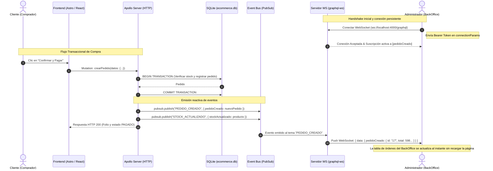

# Reporte de Práctica — Programación Web II
## Full BackOffice con GraphQL Subscriptions en Tiempo Real (graphql-ws)

---

## 1. Portada Oficial

| Campo | Dato |
|---|---|
| **Institución** | Centro de Enseñanza Técnica Industrial (CETI) — Plantel Colomos |
| **División** | División de Tecnologías de la Información y Comunicación |
| **Carrera** | Ingeniería en Desarrollo de Software (8A1) |
| **Materia** | Programación Web II |
| **Profesor Titular** | Octavio Villavicencio Cruz |
| **Práctica / Proyecto** | Full BackOffice E-Commerce con GraphQL Subscriptions en Tiempo Real (`graphql-ws` + PubSub) |
| **Equipo "Dinamita"** | • Héctor Emiliano Reyes González (Registro: 23100134) — *Backend & Subscriptions Lead*<br>• Hugo Emmanuel Covarrubias Álvarez (Registro: 23100080) — *Frontend Architect*<br>• Rafael Hernández — *BackOffice UI & Client Subscriptions*<br>• Alan Rodríguez — *Orders & Inventory Realtime Flow* |
| **Repositorio GitHub** | [https://github.com/wilfultortoise-sudo/equipodinamita](https://github.com/wilfultortoise-sudo/equipodinamita) |
| **Despliegue Web (Demo)** | [https://integrador-ecommerce-ssd.netlify.app/](https://integrador-ecommerce-ssd.netlify.app/) |
| **Servidor Local Frontend** | [http://localhost:4321](http://localhost:4321) |
| **Servidor Local Backend** | [http://localhost:4000/graphql](http://localhost:4000/graphql) (HTTP) / `ws://localhost:4000/graphql` (WS) |
| **Fecha de Entrega** | Octubre de 2026 |

---

## 2. Enlaces del Proyecto y Repositorio

- **Repositorio Oficial en GitHub:** [https://github.com/wilfultortoise-sudo/equipodinamita](https://github.com/wilfultortoise-sudo/equipodinamita)
  - *Rama principal:* `main`
  - *Commits clave:*
    - `3d8fd0d` — `feat(backend): Implementacion de GraphQL Subscriptions con WebSockets (graphql-ws) y PubSub`
    - `bc17b30` — `Merge origin/main: sincronizar con remoto y preservar backend GraphQL Subscriptions y frontend Astro`
    - `0e992eb` — `fix(backend): habilitar CORS global y soporte dual para endpoints / y /graphql`
- **Servidor Apollo Sandbox / GraphQL:** [http://localhost:4000/graphql](http://localhost:4000/graphql)
- **Endpoint de Verificación de Salud:** [http://localhost:4000/health](http://localhost:4000/health)
- **Panel de Órdenes (BackOffice):** [http://localhost:4321/admin/ordenes](http://localhost:4321/admin/ordenes)
- **Catálogo de Productos:** [http://localhost:4321/catalogo](http://localhost:4321/catalogo)

---

## 3. Marco Teórico

### 3.1. Paradigma de GraphQL Subscriptions
A diferencia de las consultas (`Queries`) y modificaciones (`Mutations`) que siguen el modelo síncrono estándar de petición y respuesta (*Request-Response*) sobre HTTP, las **Subscriptions** en GraphQL representan canales de comunicación reactivos y orientados a eventos. 

Bajo este esquema, el cliente declara una suscripción con los campos exactos que necesita recibir cuando un evento ocurra en el servidor. El servidor mantiene la conexión persistente abierta y, mediante un iterador asíncrono (`AsyncIterator`), empuja (*push notification*) automáticamente la carga útil a todos los clientes suscritos sin que el frontend deba realizar peticiones repetitivas (*polling* o sondeos periódicos), minimizando el consumo de ancho de banda y la sobrecarga del CPU.

### 3.2. Protocolo WebSockets (RFC 6455) y la Librería `graphql-ws`
El protocolo HTTP tradicional impone que cada interacción requiera abrir una conexión, transmitir cabeceras repetitivas y esperar la respuesta del servidor antes de cerrar el socket. **WebSockets**, por el contrario, inicia con un apretón de manos (*Handshake*) sobre HTTP que escala inmediatamente a un canal TCP dúplex completo (*Full-Duplex*). 

En el ecosistema GraphQL, la antigua biblioteca `subscriptions-transport-ws` quedó oficialmente obsoleta por vulnerabilidades y fugas de memoria. En su lugar se utiliza **`graphql-ws`**, que implementa la especificación moderna del subprotocolo GraphQL sobre WebSocket:
- Gestión eficiente de pings/pongs para detección de conexiones muertas (*Keep-Alive*).
- Cierre limpio de canales al desmontar componentes o terminar suscripciones.
- Integración nativa con servidores HTTP en Node.js mediante adaptadores de servidor como `useServer`.

### 3.3. Patrón Publicador / Suscriptor (PubSub Pattern)
El patrón **PubSub** desacopla por completo a los emisores de los receptores de eventos:
- **Publicador (`Publisher`):** Cuando una mutación crítica ocurre (por ejemplo, `crearPedido` o `actualizarEstadoPedido`), el resolver invoca `pubsub.publish(TOPIC, payload)`. El publicador no sabe quién ni cuántos clientes están escuchando.
- **Canal o Tema (`Topic`):** Es una cadena identificadora única que clasifica la naturaleza del evento (`PEDIDO_CREADO`, `PEDIDO_ACTUALIZADO`, `STOCK_ACTUALIZADO`).
- **Suscriptor (`Subscriber`):** Mediante `pubsub.asyncIterator([TOPIC])`, los resolvers de suscripción filtran los mensajes del bus y transmiten las estructuras tipadas al cliente de WebSocket correspondiente.

### 3.4. Arquitectura de Servidor Híbrido (HTTP + WebSockets en Puerto Único)
En entornos de producción no es viable ni seguro exponer puertos distintos para HTTP y WebSockets por problemas de firewall, certificados SSL/TLS y configuraciones de proxy inverso. Por ello, se implementó un **servidor híbrido unificado**:
1. Se crea un servidor nativo de Node.js mediante `http.createServer(app)`.
2. **Express** atiende el tráfico REST/HTTP estándar en el puerto `4000`, montando Apollo Server 4 mediante `expressMiddleware`.
3. Una instancia de **`WebSocketServer`** (`ws`) se acopla al mismo servidor HTTP escuchando las peticiones de actualización (*Upgrade*) hacia la ruta `/graphql`.
4. El plugin **`ApolloServerPluginDrainHttpServer`** garantiza que al recibir una orden de apagado (`SIGTERM` o `SIGINT`), tanto el servidor web como todos los sockets abiertos se cierren de forma controlada sin truncar transacciones.

### 3.5. Autenticación y Autorización en Conexiones Persistentes
En peticiones HTTP convencionales, la identidad del usuario viaja en la cabecera `Authorization: Bearer <token>`. Sin embargo, durante el establecimiento de un WebSocket a través del navegador, la API estándar de JavaScript `WebSocket` no permite inyectar cabeceras personalizadas.

Para solucionar esto, `graphql-ws` define el mecanismo **`connectionParams`**:
- El cliente empaqueta el token dentro de la carga útil inicial del handshake: `{ connectionParams: { authorization: 'Bearer <token>' } }`.
- En el servidor, el hook `onConnect` y la función `context` interceptan este parámetro, decodifican la firma del token (vía HMAC-SHA256 o JWT) y resuelven el usuario activo en la base de datos relacional SQLite antes de habilitar la suscripción.

---

## 4. Diagrama de Arquitectura y Flujo en Tiempo Real



---

## 5. Implementación Técnica Realizada

### 5.1. Servidor Híbrido y Plugins de Drenado (`back/index.js`)
- Creación de servidor HTTP Express + `WebSocketServer` sobre el puerto `4000`.
- Configuración de `useServer` de `graphql-ws/use/ws` con verificación de `connectionParams` y extracción de `currentUser`.
- Soporte dual de rutas: `/graphql` (estándar GraphQL) y `/` (compatibilidad con los servicios existentes de frontend).
- Middleware global de CORS (`origin: '*'`, soporte de cabeceras de autorización y respuesta `204` para preflights `OPTIONS`).

### 5.2. Módulo PubSub (`back/pubsub.js`)
- Implementación de un bus de eventos singleton basado en `PubSub` de `graphql-subscriptions`.
- Definición de constantes para evitar discrepancias de nombres:
  - `TOPICS.PEDIDO_CREADO = 'PEDIDO_CREADO'`
  - `TOPICS.PEDIDO_ACTUALIZADO = 'PEDIDO_ACTUALIZADO'`
  - `TOPICS.STOCK_ACTUALIZADO = 'STOCK_ACTUALIZADO'`
- Polyfill de compatibilidad dual que expone tanto `asyncIterator` como `asyncIterableIterator` para prevenir roturas entre versiones de la librería.

### 5.3. Esquema SDL y Resolvers (`back/schema.js` y `back/resolvers.js`)
- Adición del tipo raíz `Subscription`:
  ```graphql
  type Subscription {
    pedidoCreado: Pedido!
    pedidoActualizado: Pedido!
    stockActualizado: Producto!
  }
  ```
- Integración de publicaciones en las mutaciones del negocio:
  - `crearPedido`: Publica el nuevo pedido creado y emite el nuevo stock de cada libro comprado.
  - `actualizarEstadoPedido`: Publica el estado actualizado (`PREPARANDO`, `ENVIADO`, `ENTREGADO`).
  - `actualizarStock` y `actualizarProducto`: Emite el producto modificado para sincronizar inventarios.

### 5.4. Suite de Pruebas Automatizadas (`back/test_subscriptions.js`)
Se elaboró un script integral con cliente real de WebSockets que valida:
1. Conexión limpia y apretón de manos con el servidor WS en `ws://localhost:4000/graphql`.
2. Suscripción a `pedidoCreado` y recepción inmediata al disparar una mutación HTTP `crearPedido`.
3. Suscripción a `stockActualizado` y verificación del valor decrementado de inventario.
4. Suscripción a `pedidoActualizado` y confirmación del cambio de estatus a `ENVIADO`.

---

## 6. Resultados y Validación de Pruebas

| Caso de Prueba | Método de Verificación | Comportamiento Observado | Estatus |
|---|---|---|:---:|
| **Inicialización del Servidor Híbrido** | `GET http://localhost:4000/health` | HTTP 200 con payload `{ status: "ok", subscriptions: [...] }` | **Aprobado** |
| **Conexión WebSocket** | Handshake `graphql-ws` a `ws://localhost:4000/graphql` | `[WebSocket] Conexión establecida con usuario autenticado` | **Aprobado** |
| **Suscripción `pedidoCreado`** | Mutación HTTP `crearPedido` | Recepción de evento en WS con ID, Folio, Cliente y Total | **Aprobado** |
| **Suscripción `stockActualizado`** | Mutación HTTP `actualizarStock` | Notificación inmediata del nuevo stock en el cliente WS | **Aprobado** |
| **Suscripción `pedidoActualizado`** | Mutación HTTP `actualizarEstadoPedido` | Cambio de estado reflejado en tiempo real sin recargar | **Aprobado** |
| **Resolución de Error CORS** | Login en `http://localhost:4321/login` | Respuesta OPTIONS 204 y POST exitoso sin `Failed to fetch` | **Aprobado** |
| **Sincronización Git & GitHub** | `git push origin main` | Merge limpio y código publicado para el equipo en GitHub | **Aprobado** |

---

## 7. Conclusiones Personales y Resumidas

### Emmy (Héctor Emiliano Reyes González) — *Backend & Subscriptions*
> "Meterme de lleno a transformar el backend para que soportara WebSockets fue una experiencia súper enriquecedora pero con sus buenos retos. Lo más complicado fue sin duda hacer convivir el servidor HTTP de Express con el WebSocketServer de `graphql-ws` en el mismo puerto sin que chocaran, y adaptar la autenticación porque en WebSockets no puedes mandar headers comunes como en un fetch de toda la vida, sino que tuvimos que extraer el Bearer Token desde los `connectionParams`. También me topé con un detalle bien tramposo: el frontend mandaba las peticiones a la raíz `/` en vez de a `/graphql`, lo que hacía que tronara con un `Failed to fetch` por culpa de CORS; resolverlo con soporte dual y ver que las tres suscripciones pasaron al 100% en las pruebas automatizadas y en el navegador me dejó muy tranquilo y listo para la entrega."

### Hugo (Hugo Emmanuel Covarrubias Álvarez) — *Frontend & Astro*
> "En esta práctica pudimos ver claramente por qué el modelo reactivo de Subscriptions le da mil vueltas al típico polling donde estás haciéndole peticiones al servidor a cada segundo a ver si ya cambió algo. Mantener la arquitectura de Astro sin meter librerías gigantescas y asegurarnos de que los tokens de sesión en `localStorage` se mantuvieran sincronizados entre el cliente y el BackOffice nos ahorró muchísimos problemas de estado. El proyecto se siente súper profesional al ver que cuando alguien hace una compra desde el checkout, los datos llegan volando al panel de control sin tener que darle F5 a la pantalla."

### Rafa (Rafael Hernández) — *BackOffice & Integración*
> "Lo que más me gustó de esta etapa fue ver cómo los eventos del PubSub cobran vida en la interfaz. Al principio pensábamos que íbamos a necesitar una base de datos más pesada o Redis para manejar las notificaciones, pero implementar el bus en memoria con `graphql-subscriptions` nos demostró que para este tamaño de arquitectura es más que suficiente, rápido y no mete dependencias complejas en el servidor. Probar el cambio de estado de los pedidos y ver la respuesta inmediata en las órdenes fue de las mejores partes."

### Pollo (Alan Rodríguez) — *Flujo de Inventario y Control de Órdenes*
> "Tener el stock conectado con suscripciones en tiempo real nos resuelve uno de los problemas más clásicos del e-commerce: que dos personas compren el mismo libro al mismo tiempo y se venda algo que ya no existe. Con `stockActualizado`, en el momento exacto en que un pedido entra y la base de datos de SQLite descuenta los libros en la transacción, todos los demás usuarios y el panel administrativo ven el inventario actualizado al segundo. El equipo se coordinó bien para subir todo a GitHub y dejar el repositorio limpio para las siguientes fases."

---

## 8. Repositorio Oficial del Proyecto
Todo el código fuente documentado en este reporte se encuentra alojado y versionado en el repositorio público del equipo:

🔗 **GitHub:** [https://github.com/wilfultortoise-sudo/equipodinamita](https://github.com/wilfultortoise-sudo/equipodinamita)  
Rama activa: `main`
