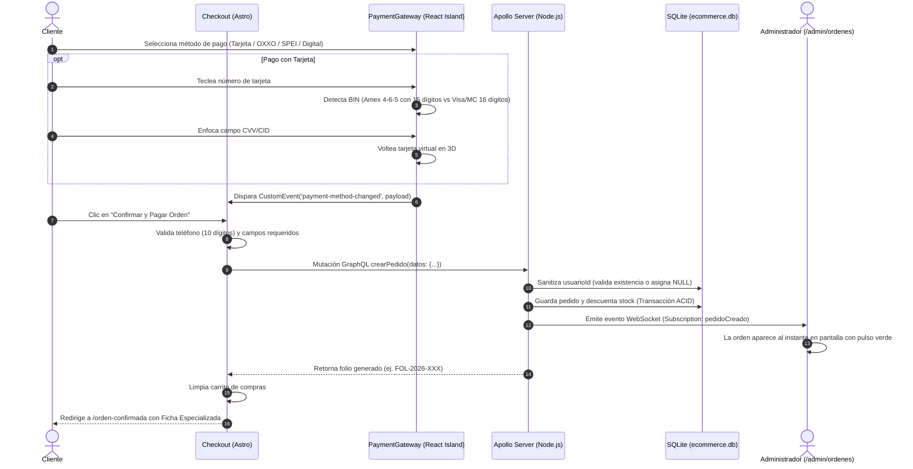
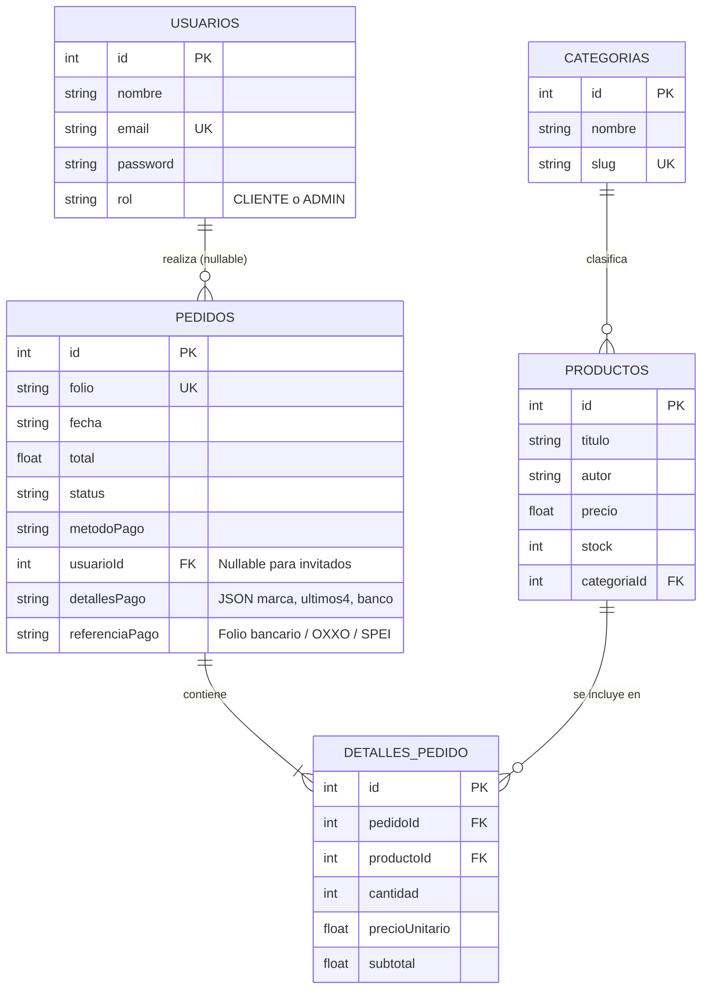

# Reporte de Proyecto Integrador — BiblioTech Store
## Entrega Final: Pasarela Multimétodo, Fichas de Pago Oficiales y BackOffice en Tiempo Real

### Portada Oficial

| Campo | Información |
|---|---|
| **Institución** | Centro de Enseñanza Técnica Industrial (CETI) — Plantel Colomos |
| **Carrera** | Tecnólogo en Desarrollo de Software |
| **Materia** | Programación Web II (PWII) / Proyecto Integrador |
| **Profesor** | Villavicencio Cruz Octavio |
| **Alumno** | Covarrubias Alvarez Hugo Emmanuel |
| **Registro** | 23100080 |
| **Proyecto** | BiblioTech Store — E-Commerce Fullstack (Astro, React Islands, Apollo GraphQL, WebSockets y SQLite) |
| **Repositorio GitHub** | [https://github.com/wilfultortoise-sudo/equipodinamita.git](https://github.com/wilfultortoise-sudo/equipodinamita.git) |
| **Servidor Frontend (Astro)** | [http://localhost:4321](http://localhost:4321) |
| **Servidor Backend (Apollo GQL)** | [http://localhost:4000/graphql](http://localhost:4000/graphql) |
| **Fecha** | Octubre del 2026 |

---

## 1. Enlaces a los Módulos del Sistema

Para la navegación y comprobación directa del proyecto tanto en local como en GitHub:

- **Repositorio Oficial en GitHub:** [https://github.com/wilfultortoise-sudo/equipodinamita.git](https://github.com/wilfultortoise-sudo/equipodinamita.git)
- **Inicio / Catálogo Principal:** [http://localhost:4321/catalogo](http://localhost:4321/catalogo)
- **Carrito de Compras:** [http://localhost:4321/carrito](http://localhost:4321/carrito)
- **Pasarela de Pago (Checkout):** [http://localhost:4321/checkout](http://localhost:4321/checkout)
- **Comprobante Digital y Fichas:** [http://localhost:4321/orden-confirmada](http://localhost:4321/orden-confirmada)
- **Panel Administrativo (Dashboard KPIs):** [http://localhost:4321/admin](http://localhost:4321/admin)
- **Gestión de Órdenes en Tiempo Real (WS):** [http://localhost:4321/admin/ordenes](http://localhost:4321/admin/ordenes)
- **Gestión de Catálogo e Inventario (CRUD):** [http://localhost:4321/admin/productos](http://localhost:4321/admin/productos)
- **Endpoint GraphQL HTTP y WebSocket:** `http://localhost:4000/graphql` y `ws://localhost:4000/graphql`

---

## 2. Marco Teórico y Arquitectura Técnica

### 2.1. Arquitectura de Islas (Astro Islands)
Para no cargar la tienda con scripts pesados ni convertirla en una SPA monolítica, se aplicó la arquitectura de **Islas de Astro (`@astrojs/react`)**:
* La estructura base (`checkout.astro`, encabezados, formularios) se genera como **HTML y CSS estático ultraligero**, sin costo de JavaScript innecesario.
* Únicamente la pasarela de cobro que requiere reactividad (giro 3D, detección de tarjetas, formateadores en tiempo real) se encapsuló en un componente React (`PaymentGateway.jsx`).
* El componente se hidrata en el navegador de manera independiente usando:
  ```html
  <PaymentGateway client:load />
  ```
* La comunicación entre la isla React y el formulario general de Astro se resolvió mediante eventos desacoplados del DOM:
  ```javascript
  window.dispatchEvent(new CustomEvent('payment-method-changed', { detail: payload }));
  ```

### 2.2. Detección Inteligente de BIN y Reglas Específicas de Tarjetas
El reconocimiento de marca se realiza evaluando el prefijo BIN del número tecleado:
* **Visa:** Comienza con `4`. Usa formato de 16 dígitos (4-4-4-4) y código CVV de 3 dígitos.
* **Mastercard:** Comienza con rangos `51-55` o `22-27`. Usa formato de 16 dígitos (4-4-4-4) y código CVV de 3 dígitos.
* **American Express (Amex):** Comienza con `3` (típicamente `34` o `37`). A diferencia de las tarjetas comunes, utiliza el estándar internacional de **15 dígitos** con formato **4 - 6 - 5** (`3782 822468 98210`) y código de seguridad **CID de 4 dígitos**.

**Reglas de validación implementadas:**
1. **Entrada puramente numérica:** Los campos de número de tarjeta, expiración y código de seguridad filtran cualquier letra o símbolo (`replace(/\D/g, '')`) y activan `inputMode="numeric"` en móviles.
2. **Longitud dinámica de seguridad:** Si es American Express, el campo cambia a `Código CID (4 dígitos)` y permite exactamente 4 dígitos. Si es Visa o Mastercard, cambia a `Código CVV (3 dígitos)` y bloquea el campo estrictamente a 3 dígitos (`maxLength={3}`). Si el usuario cambia de Amex a otra tarjeta, el valor se recorta automáticamente a 3 dígitos.
3. **Titular en mayúsculas:** El campo de nombre solo permite letras y espacios, forzando mayúsculas bancarias.

### 2.3. Persistencia Relacional con SQLite Nativo y Blindaje Foreign Key
El backend se unificó en Node.js usando el módulo nativo de alto rendimiento `node:sqlite` (`DatabaseSync`), guardando la base de datos directamente en el archivo portable `back/ecommerce.db`.

**Blindaje contra fallos de Foreign Key:**  
En SQLite, al tener activadas las claves foráneas (`PRAGMA foreign_keys = ON;`), si un usuario enviaba un `usuarioId` que no existía en la base de datos, la compra se caía con el error:
$$\text{SqliteError: FOREIGN KEY constraint failed}$$

Se implementó una capa de validación en `back/db.js`:
1. Comprueba si el `usuarioId` existe en la tabla `usuarios`.
2. Si no existe por ID, revisa si el correo electrónico coincide con algún usuario registrado para vincular la orden.
3. Si el usuario no existe en la base de datos (compra como invitado), asigna de forma segura `validUsuarioId = null`. Al permitir nulos la relación `ON DELETE SET NULL`, la transacción se ejecuta de forma atómica y consistente (cumpliendo principios ACID).

### 2.4. Suscripciones en Tiempo Real (GraphQL Subscriptions con WebSockets)
Para que el panel de administración reciba las ventas al instante:
* El backend corre un servidor HTTP con Express y un servidor WebSocket dedicado (`wsServer`) en la misma ruta `/graphql` usando el protocolo moderno `graphql-ws`.
* Cuando un cliente termina una compra en el checkout, el resolver de `crearPedido` emite el evento:
  ```javascript
  safePublish(TOPICS.PEDIDO_CREADO, { pedidoCreado: nuevoPedido });
  ```
* La página de órdenes de administración (`/admin/ordenes`) mantiene una conexión WebSocket con el subprotocolo `graphql-transport-ws`. Al emitirse la compra, la orden entra de inmediato al inicio de la tabla con animación de pulso verde y alerta flotante, sin tener que recargar la página.

### 2.5. Seguridad y Control de Acceso (RBAC)
Las rutas del BackOffice (`/admin`, `/admin/productos`, `/admin/ordenes`) cuentan con doble protección:
1. **En Frontend:** Valida la sesión y el rol. Si el usuario no ha iniciado sesión o su cuenta tiene rol `CLIENTE`, se oculta todo el panel y se muestra una pantalla de **Acceso Denegado** con icono de candado.
2. **En Backend (GraphQL):** Funciones de protección `requireAdmin(context)` bloquean cualquier mutación privilegiada (como `eliminarProducto`) si el token Bearer no corresponde a un administrador.

---

## 3. Diagramas del Sistema

### 3.1. Diagrama de Secuencia: Flujo de Pago y Notificación en Tiempo Real



### 3.2. Diagrama Entidad-Relación (Base de Datos SQLite)



---

## 4. Módulos Desarrollados en Detalle

### 4.1. Pasarela Multimétodo Interactiva (`PaymentGateway.jsx`)
* **American Express optimizado:** Agrupamiento automático en bloques 4-6-5, badge visible `AMERICAN EXPRESS` y campo `Código CID (4 dígitos)`.
* **Visa y Mastercard:** Formato estándar 4-4-4-4 de 16 dígitos con código de seguridad de 3 dígitos (`maxLength={3}`).
* **Tarjeta virtual 3D:** Volteo animado sincronizado con el foco del código de seguridad mostrando banda magnética y chip.
* **OXXO Pay:** Generación de referencia numérica de 14 dígitos, simulación gráfica de código de barras y vigencia de 48 horas.
* **SPEI:** CLABE interbancaria (18 dígitos) del banco STP con botón de copiado rápido al portapapeles.
* **Billeteras Digitales:** Soporte visual para Mercado Pago y PayPal Sandbox.

### 4.2. Fichas de Pago Oficiales Diferenciadas (`orden-confirmada.astro`)
Al terminar una compra, el comprobante ya no es genérico; genera una ficha especializada según el método elegido:
1. **Tarjeta (Visa, Mastercard, Amex):** Muestra un **Voucher Electrónico Bancario POS Virtual** con badge oficial de la marca, tarjeta enmascarada (`•••• •••••• •1234`), código de autorización bancaria (`AUTH-XXXXXX`), titular y confirmación de pago en línea.
2. **OXXO Pay:** Muestra la **Ficha Oficial de Depósito en Efectivo** con código de barras escaneable, referencia de 14 dígitos en bloques (`XXXX XXXX XXXX XX`), botón de copiado, desglose del total + $15 de comisión e instrucciones paso a paso para el cajero de OXXO.
3. **SPEI:** Muestra la **Ficha de Transferencia Interbancaria** con la CLABE única de 18 dígitos, banco destino STP, beneficiario oficial, concepto de pago y botón de copiado.
4. **Mercado Pago y PayPal:** Muestran sus respectivos comprobantes digitales con ID de transacción único, sello de protección al comprador y estado acreditado.
5. **Impresión PDF:** Botón superior para imprimir o guardar el recibo completo en formato PDF con formato limpio (`@media print`).

### 4.3. BackOffice y Suscripciones en Vivo (`/admin` y `/admin/ordenes`)
* **Dashboard (`admin/index.astro`):** Cálculo de KPIs en tiempo real (Ventas totales acumuladas, Total de órdenes registradas, Órdenes en preparación, Libros en catálogo y Ticket promedio).
* **Gestión de Órdenes con WebSockets (`admin/ordenes.astro`):**
  - Indicador de estado en vivo: `🟢 En vivo (WS Conectado)`.
  - Escucha la suscripción GraphQL `pedidoCreado`. Cuando se procesa una compra en el checkout, la orden cae en vivo al inicio de la lista con animación verde y alerta Toast.
  - Selector de cambio de estado para avanzar pedidos a `PREPARANDO`, `ENVIADO` o `ENTREGADO`.
* **Gestión de Productos (`admin/productos.astro`):** CRUD completo con modal para registrar libros, edición de información, ajuste rápido de existencias y eliminación con modal de confirmación.

---

## 5. Pruebas y Validación Técnica

| Caso de Prueba | Procedimiento | Resultado Obtenido | Estatus |
|---|---|---|:---:|
| **Validación American Express** | Ingreso de tarjeta iniciando con `3` | Detección inmediata de marca, formato 4-6-5 (15 dígitos) y bloqueo de CID a 4 dígitos | **Aprobado** |
| **Validación Visa / Mastercard** | Ingreso de tarjeta iniciando con `4` o `5` | Formato 4-4-4-4 (16 dígitos) y bloqueo de CVV estrictamente a 3 dígitos | **Aprobado** |
| **Filtro Estricto de Números** | Intento de teclear letras o símbolos en tarjeta o CVV | El sistema elimina de inmediato cualquier carácter no numérico | **Aprobado** |
| **Giro 3D de Tarjeta** | Enfoque y desenfoque del campo CVV/CID | Giro tridimensional mostrando el reverso y banda magnética | **Aprobado** |
| **Ficha Diferenciada OXXO** | Compra seleccionando OXXO Pay | Emisión de ficha con código de barras, referencia de 14 dígitos e instrucciones de caja | **Aprobado** |
| **Ficha Diferenciada SPEI** | Compra seleccionando SPEI | Emisión de ficha con CLABE de 18 dígitos, banco STP y botón de copiado funcional | **Aprobado** |
| **Voucher POS de Tarjeta** | Compra con tarjeta bancaria | Generación de voucher bancario con código de autorización y tarjeta enmascarada | **Aprobado** |
| **Sanitización Foreign Key SQLite** | Compra con usuario no registrado o sesión caducada | Se inserta con `usuarioId = null` sin error de clave foránea | **Aprobado** |
| **Protección RBAC (Cliente a Admin)** | Cliente intenta entrar a `/admin` pegando la URL | Bloqueo inmediato con pantalla de Acceso Denegado y candado | **Aprobado** |
| **Suscripción WS en Vivo** | Compra en `/checkout` con panel `/admin/ordenes` abierto | La orden entra en vivo al inicio de la lista con animación sin recargar página | **Aprobado** |
| **Compilación del Proyecto** | Ejecución de `npm run build` en Astro | 26 rutas estáticas compiladas en 1.55s con 0 errores | **Aprobado** |

---

## 6. Conclusión Personal

**Alumno:** Hugo Emmanuel Covarrubias Alvarez (Registro: 23100080)

La realización y consolidación de esta entrega para el proyecto integrador me permitió entender en la práctica cómo se construye una aplicación web transaccional real, integrando tecnologías modernas como Astro, React, Apollo GraphQL y WebSockets.

Uno de los mayores aprendizajes fue trabajar con la **arquitectura de islas**. Al principio existía la duda de si el proyecto era una SPA tradicional o páginas sueltas; implementar la pasarela de pagos como una isla de React (`client:load`) dentro de una página estática de Astro me dejó claro cómo se logra el balance entre velocidad de carga y componentes altamente interactivos. La tarjeta virtual en 3D y la detección automática de tarjetas (especialmente el formato particular de American Express en bloques 4-6-5 con CID de 4 dígitos) le dieron un nivel de pulido profesional a la experiencia de usuario.

Por otra parte, resolver el problema de las **fichas de pago diferenciadas** le aportó mucho valor al sistema. En un comercio real, un pago en OXXO no puede mostrar lo mismo que una tarjeta; ahora, al confirmar la compra, el cliente recibe un comprobante hecho a la medida: el voucher bancario para tarjetas, la ficha con código de barras e instrucciones de caja para OXXO, o los datos interbancarios CLABE para SPEI, listos para guardarse o imprimirse en PDF.

Finalmente, ver en funcionamiento el **BackOffice con suscripciones GraphQL en tiempo real** fue muy satisfactorio. Conectar el cliente WebSocket para que las órdenes aparezcan de forma instantánea en la pantalla del administrador en cuanto el cliente da clic en comprar demuestra el poder de una arquitectura reactiva bien implementada. Me voy muy satisfecho con los resultados obtenidos y con la solidez técnica con la que quedó funcionando el sistema.
